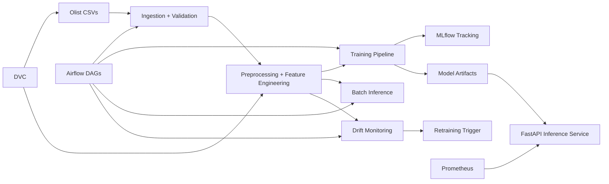

# ecommerce-forecasting-recommender

Production-oriented MLOps repository that uses the Olist Brazilian E-Commerce Public Dataset for:

1. Product demand forecasting from historical orders
2. Personalized product recommendations from purchase history

## Architecture



## Repository layout

- `data/raw`, `data/processed`, `data/reference`
- `src/ecommerce_forecasting_recommender`: modular pipelines, models, API, monitoring
- `airflow/dags`: ingestion/validation, training, and monitoring DAGs
- `scripts`: local entrypoints for data and training tasks
- `tests`: unit, integration, data-quality, and API tests
- `.github/workflows/ci.yml`: lint, test, and Docker build CI

## Local setup

```bash
python -m venv .venv
source .venv/bin/activate
pip install -U pip
pip install -e .[dev]
cp .env.example .env
```

## Dataset download and validation

Use either real Olist CSV/zip assets (not committed) or local sample bootstrap:

```bash
python scripts/download_olist_data.py
python scripts/validate_olist_data.py
```

## Train forecasting and recommender models

```bash
python scripts/train_models.py
```

Artifacts:
- Forecast model: `models/forecast_model.pkl`
- Recommender model: `models/recommender.pkl`
- Processed tables: `data/processed/*.csv`

## FastAPI serving

```bash
uvicorn ecommerce_forecasting_recommender.api.main:app --reload
```

Endpoints:
- `GET /health`
- `POST /forecast`
- `POST /recommendations`
- `GET /metrics` (Prometheus format)

## MLflow

By default, tracking uses local file storage (`MLFLOW_TRACKING_URI=file:./mlruns`).
When MLflow is not available, training continues with best-effort logging.

## DVC

```bash
dvc repro
```

`dvc.yaml` defines data download, validation, and training stages and versions raw/processed/model outputs.

## Airflow

DAGs:
- `olist_ingestion_validation`
- `olist_training`
- `olist_inference_monitoring`

Run with Docker Compose services or your own Airflow deployment.

## Docker Compose

```bash
docker compose up --build
```

Includes API, MLflow, and Airflow webserver/scheduler for local orchestration.

## Drift monitoring and retraining workflow

1. Generate drift report with `python scripts/generate_drift_report.py`
2. Compare shifts against threshold in `config/settings.yaml`
3. Trigger `scripts/train_models.py` if threshold exceeded
4. Register new model version, keep prior artifact for rollback

## Newly annotated data workflow

1. Add new curated CSV snapshots to `data/raw` (never commit proprietary/raw secrets)
2. Re-run validation and preprocessing
3. Re-train models and compare metrics to active baseline
4. Promote only when validation gates pass

## Model governance: versioning, gates, rollback, reproducibility

- Version model artifacts through DVC and MLflow run metadata
- Validation gates: schema validation + forecast MAE comparison + API smoke tests
- Rollback: point serving config to previous `models/*.pkl` or prior DVC/MLflow version
- Reproducibility: pin dependencies in `pyproject.toml`, keep deterministic pipeline stages in `scripts/` and `dvc.yaml`

## Tools used and why

- **Pandas**: reliable tabular preprocessing and feature engineering
- **scikit-learn**: lightweight baseline training for forecasting
- **MLflow**: experiment tracking and model version lineage
- **DVC**: dataset/artifact versioning and reproducible pipelines
- **Airflow**: orchestrating ingestion, training, inference, and monitoring
- **FastAPI**: production API serving for forecast/recommendation endpoints
- **Prometheus metrics**: request count/latency observability
- **Evidently-compatible drift workflow**: report generation hooks for drift analysis

## Security and data handling

- No credentials in source control
- `.env` ignored, `.env.example` provided
- Raw Olist datasets are not committed
